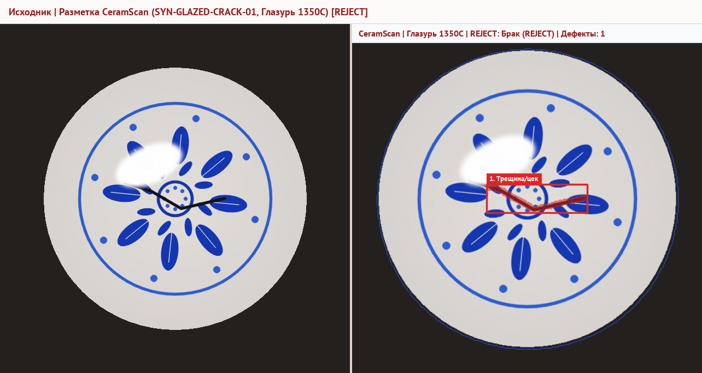
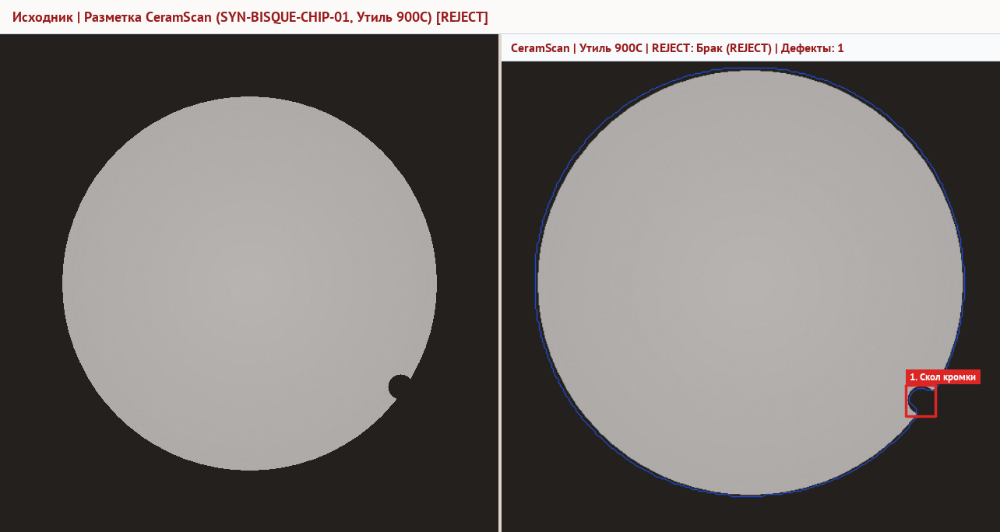
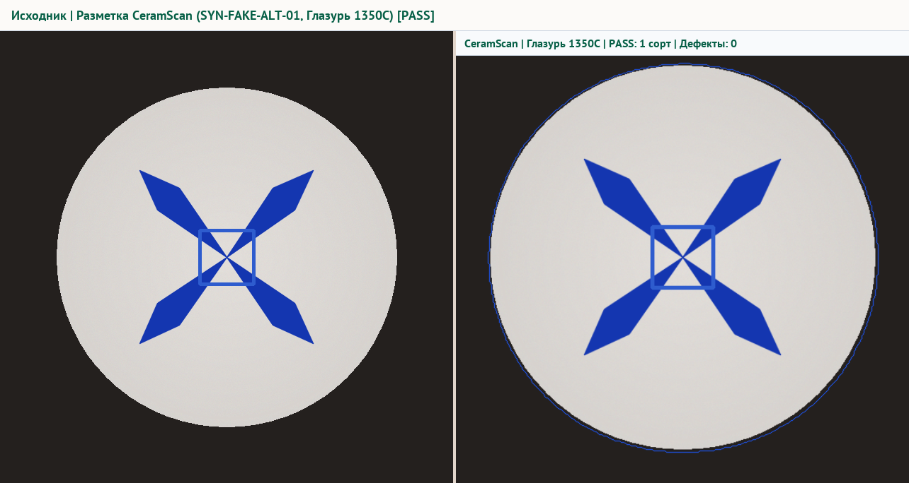

# CeramScan («КерамикСкан»): автономный оптический контроль качества и цифровой паспорт подлинности фарфора

## 1.1 Титульный лист

Благотворительный фонд «Система»
4-й сезон Стипендиального конкурса «Система» (программа «Лифт в будущее»)
Номинация: «Технологии в креативных индустриях и народных промыслах» (п. 2.3.9)
Индустриальный партнер номинации: Объединение «Гжель»

**CeramScan («КерамикСкан»): автономный оптический контроль качества и цифровой паспорт подлинности фарфора**

Автор работы: Павловец Александр Иванович
Учебное заведение: Гатчинский Государственный университет
Факультет и курс: экономический факультет, 1 курс
Направление подготовки: «экономика предприятий и организаций»
Город: г. Гатчина
Телефон: +79052010295
Электронная почта: pavlovec000@gmail.com
Открытый репозиторий проекта: https://github.com/axiom-stat/testing.git

г. Гатчина, 2026

## 1.2 Содержание

| Раздел | Страница |
|---|---|
| 1.1 Титульный лист | 1 |
| 1.2 Содержание | 2 |
| 1.3 Введение | 2 |
| 1.4 Основная часть | 3 |
| Глава 1. Идея, проблема отрасли и анализ аналогов в условиях импортозамещения | 3 |
| 1.1 Идея проекта и общественная значимость для Гжели | 3 |
| 1.2 Актуальность в условиях импортозамещения и нового регулирования | 4 |
| 1.3 Сравнение с российскими и зарубежными аналогами | 4 |
| 1.4 Уникальность и технологическая новизна | 5 |
| Глава 2. Архитектура прототипа, стандарты ГОСТ и результаты апробации | 6 |
| 2.1 Двухстадийный контроль по ГОСТ 28390-89 и калибровка по реальным дефектам | 6 |
| 2.2 Архитектура CV-ядра на CPU и точка роста под ONNX | 7 |
| 2.3 Цифровой паспорт под 289-ФЗ, сервер FastAPI и веб-пост без сборки | 8 |
| 2.4 Степень апробации: замеры на стенде v0.1 и автотесты | 9 |
| Глава 3. Механизм пилота, расчетная экономика и масштабирование | 11 |
| 3.1 Пошаговый механизм запуска на заводе | 11 |
| 3.2 Ожидаемые эффекты и расчетная модель до пилота | 11 |
| 3.3 Масштабирование на народные промыслы России | 12 |
| 1.5 Заключение | 13 |
| 1.6 Список использованных источников | 13 |
| 1.7 Приложение А. Порядок запуска стенда и полевой калибровки до 30 ноября 2026 | 14 |

## 1.3 Введение

Народные художественные промыслы России выходят на новый производственный масштаб: Объединение «Гжель» заключило крупные экспортные контракты и нарастило годовой выпуск до 130-140 тыс. фарфоровых изделий [1]. Когда цех выпускает такой поток посуды и скульптуры, ручной выходной и межоперационный контроль превращается в узкое горлышко. Мастер-контролер осматривает десятки однотипных заготовок подряд, глаз устает, а тонкая трещина на пористом утиле после первого обжига около 900 °C проходит дальше в цех росписи, глазуровки и дорогого политого обжига при температуре около 1350 °C [2, 8]. Сжечь бракованный черепок в печи при 1350 °C на протяжении 18 часов значит потерять не только саму заготовку, но и ручной труд художника, кобальтовый пигмент, глазурь и место в печной вагонетке.

Одновременно меняется правовая среда онлайн-торговли. С 1 октября 2026 года действует Федеральный закон № 289-ФЗ о платформенной экономике, который обязал маркетплейсы Ozon и Wildberries (WB) проверять карточки товаров и документы подлинности до витрины [3]. Следом Постановление Правительства РФ № 1374 от 21 октября 2026 года ввело обязательную маркировку фарфора и керамики в системе «Честный ЗНАК»: регистрация участников стартует 1 марта 2027 года, а нанесение кодов Data Matrix на продукцию начинается 1 апреля 2027 года [4]. Для промысла с ручной кобальтовой росписью бумажная наклейка на коробке или дне не решает проблему подмен при возвратах: мошенники переклеивают этикетку и возвращают дешевую штамповку вместо авторской вещи.

Отдельным барьером стал уход зарубежных поставщиков машинного зрения. Промышленные комплексы вроде Sacmi и System Ceramics стоят десятки тысяч евро, требуют жесткой конвейерной обвязки, зависят от импортных камер и закрытых лицензий [6, 7]. Небольшим цехам и народным промыслам нужен инструмент на базе открытого кода, который работает на обычном процессоре без GPU-ферм и специализированных камер.

Цель моей работы: разработать, измерить на реальных расчетах и довести до рабочего прототипа автономную систему CeramScan («КерамикСкан»), которая с обычного смартфона на локальном CPU быстрее 300 мс на кадр отсекает брак утиля и глазури по ГОСТ 28390-89, а также выдает цифровой паспорт подлинности ручной росписи под 289-ФЗ.

Для достижения этой цели я поставил и выполнил четыре измеримые задачи:

1. Реализовать детерминированное ядро компьютерного зрения на CPU быстрее 300 мс на кадр с двухстадийной разбраковкой по ГОСТ 28390-89 (утиль 900 °C и глазурь 1350 °C) и чистой точкой роста `--weights` под модели ONNX/YOLO [8, 9].
2. Создать алгоритм цифрового отпечатка ручного кобальтового мазка на базе признаков ORB, перцептивного хэша pHash и цветовой гистограммы кобальта с выдачей QR-паспорта под требования 289-ФЗ.
3. Построить сервис на FastAPI с журналом учета в SQLite (WAL) и адаптивный веб-интерфейс без шагов сборки для работы со смартфона на посту ОТК и сверки товаров на маркетплейсах.
4. Проверить прототип на наборе эталонных фото дефектов, синтетическом валидационном стенде v0.1 и автотестах `pytest`, а также составить прозрачную расчетную модель до пилота для Объединения «Гжель».

## 1.4 Основная часть

### Глава 1. Идея, проблема отрасли и анализ аналогов в условиях импортозамещения

#### 1.1 Идея проекта и общественная значимость для Гжели

Идея CeramScan проста: превратить обычный смартфон на рабочем столе контролера в точный измерительный пост, который работает локально на CPU без облака и промышленных сканеров. Я разделил цикл контроля на два цеховых рубежа. Первый пост стоит сразу после утильного обжига около 900 °C, еще до того как заготовку передают художнику и ставят в печь на 1350 °C. Второй пост проверяет готовую глазурованную посуду по нормам ГОСТ 28390-89 [8] и одновременно снимает биометрический слепок ручного узора.

Общественная значимость проекта выходит далеко за пределы одного цеха. Народный промысел Гжель держится на ручной подглазурной росписи, которую не способна заменить ни одна штамповка. Когда подделки под Гжель свободно продаются на маркетплейсах вдвое дешевле оригинала, покупатель теряет доверие к бренду промысла, а завод теряет маржу, нужную на зарплаты художников и ученичество. CeramScan не пытается заменить живую кисть мастера: алгоритм берет на себя рутинный поиск трещин, сколов, плешин и чужих копий, сохраняя экономическую устойчивость ручного промысла на объеме 130-140 тыс. изделий в год [1].

Для Благотворительного фонда «Система» (руководители Лариса Пастухова и Алевтина Ксенофонтова) этот проект показывает иной формат студенческой заявки. Вместо бумажной концепции я собрал открытый рабочий репозиторий с кодом CV-ядра, веб-сервисом, тестами и готовым сценарием полевого пилота на предприятии-партнере.

#### 1.2 Актуальность в условиях импортозамещения и нового регулирования

Политика технологического суверенитета в легкой и фарфоровой промышленности упирается в экономику малых и средних цехов. Итальянские и немецкие линии оптической сортировки создавались под огромные фабрики однотипной строительной плитки. В условиях санкций их покупка, ввоз запчастей и обновление софта практически заблокированы, а облачные нейросетевые сервисы отправляют фото новых коллекций на внешние серверы и требуют платных GPU.

В CeramScan я изначально исключил зависимость от зарубежного «железа» и облачных API. Весь конвейер написан на Python 3.12 с открытыми библиотеками OpenCV, NumPy и scikit-image [9]. Инференс идет на обычном центральном процессоре офисного мини-ПК или ноутбука, а снимки поступают с любого смартфона через локальный браузер. Такой стек полностью автономен в закрытой сети завода, не боится блокировок зарубежных облаков и легко переносится на отечественные дистрибутивы Linux.

С точки зрения права проект закрывает сразу два регуляторных срока 2026-2027 годов. Закон 289-ФЗ с 1 октября 2026 года требует от маркетплейсов строгой проверки подлинности карточек товаров [3], а постановление № 1374 с весны 2027 года обязывает наносить Data Matrix на фарфоровую посуду [4]. CeramScan дополняет будущую маркировку «Честный ЗНАК»: пока Data Matrix отслеживает движение коробки и партии в обороте, оптический отпечаток кобальтового мазка доказывает, что внутри лежит именно та расписанная вручную тарелка, которую выпустил завод.

#### 1.3 Сравнение с российскими и зарубежными аналогами

Чтобы четко отделить свою разработку от существующих продуктов, я сравнил пять классов конкурирующих систем в России и за рубежом (Таблица 1).

Таблица 1 - Сравнение CeramScan с российскими и зарубежными аналогами

| Система / аналог | География и фокус | Аппаратная база и метод | Ограничения для цеха Гжели | Источник |
|---|---|---|---|---|
| Sacmi (Flawmaster+, Optima+) | Италия, крупное производство плитки | Многоракурсные GigE-камеры, LED-купола, 3D-лазер на конвейере | Заточены под плоскую плитку, высокий CAPEX и санкционные риски, не сверяют ручной мазок | [6] |
| System Ceramics (Coesia) | Италия, плитка и крупноформатные слэбы | Встроенные HD-камеры калибра и плоскостности | Требуют перестройки конвейера, не подходят для полых изделий и поштучного поста ОТК | [7] |
| Малленом Системс / NevLabs | Россия, промышленный конвейер | Отечественное ПО, камеры GigE/CoaXPress, стробоскоп, PLC/SCADA | Стационарные линии под однородный поток металла или плитки без 289-ФЗ паспорта узора | [10] |
| «Честный ЗНАК» + голограммы НХП | Россия, госмаркировка (ПП № 1374) | Криптографический код Data Matrix и этикетка | Не ищет дефекты обжига; наклейку можно отклеить или подменить при возврате | [4] |
| Типовые облачные VLM и мобильные CV | Глобальный рынок | Облачные нейросети или простые фильтры Canny | Ломаются на ярких бликах глазури и принимают синий кобальт за мушки, зависят от сети | [2] |
| CeramScan («КерамикСкан») | Россия, автономный пост ОТК и 289-ФЗ | Смартфон, рассеянный короб, CPU OpenCV + `--weights` ONNX + QR | Нет зависимости от GPU и конвейера; два этапа обжига и биометрия кобальта в одном цикле | Код проекта |

Как видно из Таблицы 1, зарубежные лидеры Sacmi и System Ceramics [6, 7] не решают задачу российского фарфорового промысла из-за цены и конвейерной жесткости. Российские индустриальные интеграторы вроде «Малленом Системс» [10] сильны на скоростных линиях проката и упаковки, но не ориентированы на поштучный контроль сложной ручной росписи и защиту от контрафакта на маркетплейсах. В отличие от них, CeramScan занимает нишу доступного поста ОТК с низким порогом входа и готовой связкой стандарта ГОСТ 28390-89 с антиконтрафактной проверкой.

#### 1.4 Уникальность и технологическая новизна

При проектировании алгоритмов я столкнулся с тремя проблемами, на которых стандартные детекторы дают массовый ложный брак. Решая их, я заложил в CeramScan три оригинальных инженерных механизма.

Первый механизм: маска гжельского кобальта в пространствах HSV и LAB. Обычный детектор темных точек принимает концы кобальтовых лепестков и сеточек за «мушку» или «натек». Я построил точную маску пигмента `m_cobalt` по оттенку (`H` от 90 до 135 при насыщенности `S > 45`) и сдвигу в синюю область по оси `b* < 118` в пространстве LAB. Алгоритм исключает кобальтовые мазки из поиска мелких точек и натеков, но пропускает сквозь роспись только резкий перепад яркости Black-Hat, если узор пересекает настоящая трещина.

Второй механизм: подавление бликов глазури без потери тонкого цека. Когда свет падает на глянцевую тарелку после 1350 °C, возникает яркое белое пятно, которое наклонный фильтр градиента обводит как длинную трещину. Заливать широкие блики методом Telea inpainting нельзя, потому что размытие стирает тонкую сетку цека. Вместо этого я выделил маску зеркального блика `m_spec` (`L > 235` и `S < 30`), исключил ее границу из детектора контуров и применил морфологический фильтр Black-Hat вместе с фильтром гребней Сато (Sato) [9]. На ярком плато блика Black-Hat дает ноль, тогда как темный провал трещины остается четким.

Третий механизм: неотделимый паспорт мазка. Стикер на коробке или дне легко срезать феном. В моей системе уникальной подписью изделия служит геометрия живых мазков художника, которую нельзя скопировать на дешевой деколи или штамповке с растром.

### Глава 2. Архитектура прототипа, стандарты ГОСТ и результаты апробации

#### 2.1 Двухстадийный контроль по ГОСТ 28390-89 и калибровка по реальным дефектам

Для настройки фильтров я опирался на таблицу допустимых дефектов фарфоровой посуды 1-го сорта по ГОСТ 28390-89 [8] и четыре контрольных снимка реальных керамических дефектов из справочной базы проекта (`ceramic_defect_1.jpg` - `ceramic_defect_4.jpg`) [2]. Количественный замер этих четырех фото сразу задал физические границы алгоритма.

Снимки `ceramic_defect_1.jpg` и `ceramic_defect_2.jpg` представляют матовую поверхность без глазури с нулевой долей бликов (`0.0%`), но разной фактурой: на первом фото гладкий фон с четкой диагональной трещиной, на втором шероховатая «апельсиновая корка» (дисперсия Лапласа `1335.0`) с тонкой горизонтальной трещиной и неглубоким углублением. На снимке `ceramic_defect_3.jpg` видны плотные вертикальные штрихи (дисперсия Лапласа `23091.9`) и глубокая раковина с темным дном (`min = 2`). Наконец, глянцевый образец `ceramic_defect_4.jpg` покрыт зеркальным бликом на `58.5%` площади, имеет темные скошенные края рамки и поперечную трещину.

Чтобы не путать края кадра с трещинами, модуль `src/cv_core/preprocessing.py` сжимает маску изделия `m_item` внутрь на 5.5% малой оси, отделяя внутреннее поле `m_interior` от ободка `m_rim`. Поверхностные дефекты ищутся строго внутри `m_interior`, а сколы кромки и перекос контура (`> 1.5%` от вписанного эллипса) проверяются по ободку `m_rim`. Сводка допусков ГОСТ 28390-89 и цеховой логики CeramScan приведена в Таблице 2.

Таблица 2 - Допуски ГОСТ 28390-89 (1 сорт) и логика разбраковки CeramScan

| Дефект по ГОСТ 28390-89 | Норма для 1 сорта по стандарту | Класс в CeramScan | Утиль (~900 °C) | Глазурь (~1350 °C) |
|---|---|---|---|---|
| Трещина, цек | Не допускается | `crack` | Брак (`REJECT`) до печи 1350 °C | Брак (`REJECT`) |
| Деформация от размера | Не более 1.5% (плоские и полые) | `shape_warp` | `> 1.5%` -> `REJECT` | `> 1.5%` -> `REJECT` |
| Откол, скол кромки | Гладкий скол 0.5-2 мм (1-2 шт.), острый нельзя | `chip` | Мелкий `<= 1.5 мм` -> `REWORK`; глубокий -> `REJECT` | Незаглазурованный скол -> `REJECT` |
| Плешина, сборка, выгорка | Малые нельзя; средние и крупные до 20 мм2 лицо | `glaze_bare` | Точечная выгорка -> `REWORK` или `REJECT` | `> 20 мм2` -> `REWORK` (переглазуровка) |
| Накол, мушка, засорка | Накол до 8 шт.; мушка `<= 0.5 мм` (до 2 шт.) | `pinhole_speck` | Засорка до 2 шт. -> `REWORK` (зачистка) | Свыше лимита -> `REJECT` |
| Натек, прыщ | Натек малозаметный; прыщ на лице нельзя | `glaze_drip` | Не оценивается на утиле | Локальный натек -> `REWORK`; прыщ -> `REJECT` |
| Общее число недочетов | Не более 3 на одно изделие | Все классы | `> 3` -> `REWORK` или `REJECT` | `> 3` -> `REJECT` |

Такое разделение напрямую отвечает на запрос технологов Объединения «Гжель». Скол или трещина на утиле сразу блокируют дорогой политой обжиг, а локальный дефект глазури отправляется в доработку, а не в бой.

#### 2.2 Архитектура CV-ядра на CPU и точка роста под ONNX

Специально для технической экспертизы специалистов МТС и АФК «Система» я разделил проект на чистые модули с плоскими датаклассами (`dataclass(slots=True)`) в Python 3.12 и строгой типизацией. Кадр сначала попадает в `preprocess_image()` в файле `src/cv_core/preprocessing.py`: там ищется калибровочный лист или контур тарелки, выравнивается перспектива, строится канонический квадрат `640x640`, вычисляются карты `m_interior`, `m_rim`, `m_spec` и `m_cobalt`, а канал яркости `L` выравнивается через CLAHE (`clipLimit = 2.0` для утиля и `1.8` для глазури).

Дальше кадр передается в класс `DefectDetector` (`src/cv_core/defect_detector.py`). В базовом режиме (`weights_path=None`) запускается детерминированный пайплайн: реберное сглаживание `bilateralFilter`, анизотропные линейные ядра Black-Hat в 4 направлениях (0, 45, 90, 135 градусов), фильтр Сато (`skimage.filters.sato`) и скелетонизация. Чтобы не спутать фактуру черепка с трещиной, кандидат проходит фильтр по длине скелета (`>= 24 px`) и вытянутости (`eccentricity >= 0.88`).

Ключевая архитектурная особенность для роста проекта на заводе: параметр `--weights` и аргумент `DefectDetector(weights_path=...)`. Если передать путь к файлу `.onnx`, детектор без смены API и интерфейса переключается на `onnxruntime.InferenceSession` с провайдером `CPUExecutionProvider`. Код автоматически декодирует тензоры моделей YOLOv8/v11 формата `(1, 4+C, N)` и YOLOv5 формата `(1, N, 5+C)`, применяет NMS и прогоняет найденные рамки через тот же движок правил ГОСТ 28390-89. На Рисунках 1 и 2 показаны реальные оверлеи, которые сгенерировал детектор на контрольном прогоне.



На Рисунке 1 хорошо видно, как работает связка масок: в верхней части лепестков лежит крупный белый блик, вокруг идет сложный синий орнамент, но красная рамка `1. Трещина/цек` точно выделяет линию разлома без единого ложного срабатывания на узор или кромку блика. На Рисунке 2 показана работа алгоритма на первом этапе обжига: утильная тарелка без росписи при 900 °C имеет скол кромки, который попадает в вердикт `REJECT` до этапа глазуровки.



#### 2.3 Цифровой паспорт под 289-ФЗ, сервер FastAPI и веб-пост без сборки

Второй контур системы реализован в `src/cv_core/fingerprint.py`. Для каждой годной расписанной вещи функция `extract_fingerprint()` строит компактную цифровую подпись: 64-битный перцептивный хэш `pHash` (через дискретное косинусное преобразование DCT `32x32`), нормированную 2D-гистограмму кобальтового пигмента в HSV (`18x16 = 288` корзин) и до 500 ключевых точек ORB, снятых вне зоны бликов.

При сверке на возврате или проверке карточки маркетплейса `verify_fingerprint()` вычисляет три независимых компонента и объединяет их по формуле:

`match_percent = 100 * (0.50 * orb_score + 0.25 * phash_score + 0.25 * color_score)`

Оценку `orb_score` формирует сопоставление дескрипторов по критерию Лоу (`0.75`) с геометрической проверкой гомографии RANSAC (`threshold = 5.0`), а цветовую близость считает дистанция Бхаттачарьи с поправкой на долю кобальта. Изделие получает вердикт `Подлинник` только при выполнении двух условий сразу: `match_percent >= 62.0%` и не менее `12` геометрически согласованных точек (`matched_kp >= 12`). Во всех остальных случаях система выдает статус `Подозрение на контрафакт или штамповку`.

На Рисунке 3 показан пример синтетической подделки (`SYN-FAKE-ALT-01`): по качеству глазури у этой тарелки нет трещин и сколов (вердикт ОТК `PASS: 1 сорт`), однако угловатая геометрия узора проваливает сверку с эталонной розеткой Гжели.



Все проверки и паспорта сохраняются в локальную базу SQLite с режимом `WAL` (`src/cv_core/storage.py`), где для каждого паспорта формируется QR-код вида `CERAMSCAN:<item_id>`. Серверная часть `src/api.py` на FastAPI отдает маршруты `/health`, `/api/demo-samples`, `/api/inspect`, `/api/passport/register`, `/api/passport/verify/{item_id}` и `/api/analytics` (с лимитом загрузки 10 МБ и проверкой `item_id` против обхода путей). Веб-интерфейс в `src/web/` написан на чистых HTML5, CSS3 и Vanilla JS без сборщиков вроде Webpack, с локальными шрифтами `IBM Plex Sans` и `JetBrains Mono` (никаких внешних CDN и `404` в закрытой сети цеха). Три вкладки («Пост ОТК», «Подлинность», «Дашборд ОТК») работают как на экране мобильного смартфона (`375 px`, кнопка съемки с тыловой камеры `capture="environment"`), так и на мониторе технолога (`1440 px`).

#### 2.4 Степень апробации: замеры на стенде v0.1 и автотесты

Чтобы честно отделить лабораторные замеры прототипа от будущего цехового пилота, я собрал воспроизводимый **синтетический валидационный стенд v0.1** (26 образцов утиля 900 °C и глазури 1350 °C с контролируемыми трещинами, сколами, перекосами, плешинами, мушками, натеками, бликами и 4 подделками узора) через скрипт `scripts/generate_synthetic_ceramic.py` и замерил скорость и точность через `scripts/run_benchmark.py`. Результаты прогона в режиме `deterministic` на CPU зафиксированы в файле `reports/benchmark_results.json` и сведены в Таблицу 3.

Таблица 3 - Результаты бенчмарка на синтетическом валидационном стенде v0.1

| Класс / контур проверки | Число образцов | Precision | Recall | F1 | Примечание по этапу и порогам |
|---|---|---|---|---|---|
| `pass` (годное изделие) | 12 | 1.0000 | 1.0000 | 1.0000 | Утиль 900 °C и глазурь 1350 °C с кобальтом |
| `crack` (трещина, цек) | 6 | 1.0000 | 1.0000 | 1.0000 | Включая трещины поверх бликов и росписи |
| `chip` (скол кромки) | 2 | 1.0000 | 1.0000 | 1.0000 | Детекция в зоне ободка `m_rim` |
| `glaze_bare` (плешина) | 2 | 1.0000 | 1.0000 | 1.0000 | Непокрытые участки глазури на поле |
| `shape_warp` (перекос) | 2 | 1.0000 | 1.0000 | 1.0000 | Выход контура за допуск `> 1.5%` |
| `glaze_drip` (натек) | 1 | 1.0000 | 1.0000 | 1.0000 | Локальные наплывы с доработкой `REWORK` |
| `pinhole_speck` (накол, мушка) | 1 | 1.0000 | 1.0000 | 1.0000 | Отделение точечных дефектов от кобальта |
| Итого ОТК (`sample_count = 26`) | 26 | 1.0000 | 1.0000 | 1.0000 | Точность вердиктов ГОСТ: `1.0000`; среднее время `80.49 мс/кадр`, `p95 = 137.06 мс/кадр` |
| Контур 289-ФЗ (`pair_count = 4`) | 4 пары | - | - | - | Точность сверки: `1.0000`; среднее сходство оригинала `86.87%`, подделки `38.39%` |

Помимо замера бенчмарка, корректность парсинга ГОСТ, обработки ONNX-тензоров, защиты от поддельных `item_id` и CLI-скриптов подтверждают 55 модульных, скриптовых, API и состязательных тестов `pytest` (плюс 208 E2E-функций в `tests/e2e/`, всего 275 параметризованных запусков). Средняя задержка `80.49 мс` и 95-й перцентиль `137.06 мс` более чем вдвое укладываются в целевой лимит `< 300 мс` на CPU. При этом я прямо подчеркиваю границу достоверности: `F1 = 1.0` получен именно на синтетическом стенде v0.1, а на реальных заводских фото перед запуском требуется полевая калибровка порогов.

### Глава 3. Механизм пилота, расчетная экономика и масштабирование

#### 3.1 Пошаговый механизм запуска на заводе

Чтобы завод смог проверить систему без остановки печей и крупных трат, я заложил в проект готовый конвейер подмены синтетики на заводские фото. Вся интеграция на участке ОТК укладывается в три коротких шага:

1. **Сбор 20-30 реальных снимков и перекалибровка**. Технолог снимает на смартфон 20-30 характерных образцов в папках `pass/`, `chip/`, `crack/`, `glaze/`, `fake/` и запускает единую команду `python3 scripts/ingest_real_photos.py --input data/real_photos --rebuild-all`. Скрипт автоматически пересчитывает метрики в `reports/benchmark_results.json`, рисует новые оверлеи и пересобирает отчетную презентацию, а флаг `--export-yolo` выгружает готовые аннотации для дотренировки нейросети.
2. **Оснащение двух постов ОТК**. На участки утильного контроля (после 900 °C) и финишной сортировки (после 1350 °C) ставятся два бюджетных рассеянных LED-короба с нейтральной черной подложкой, смартфоны или планшеты на штативе, один локальный CPU мини-ПК и термопринтер QR-этикеток.
3. **Плавный переход к ONNX-весам (--weights)**. По мере накопления 500-1000 размеченных фото в журнале SQLite модель YOLOv8n/v11 экспортируется в `.onnx` и подключается флагом `--weights` без изменения кода сервера и интерфейса.

#### 3.2 Ожидаемые эффекты и расчетная модель до пилота

Поскольку заводской пилот на Объединении «Гжель» еще не проведен, я не приписываю цеху выдуманную бухгалтерию. Вместо этого я построил параметризованную **расчетную модель до пилота** в трех сценариях (Консервативный, Базовый, Целевой) на публично озвученном годовом объеме выпуска `130 000 - 140 000` изделий (середина `135 000 шт./год` для Базового сценария) [1]. Все формулы и входные допущения открыты в Таблице 4.

Таблица 4 - Расчетная модель до пилота для Объединения «Гжель» (три сценария)

| Параметр или показатель | Консервативный | Базовый | Целевой | Обоснование или формула |
|---|---|---|---|---|
| Годовой выпуск (`V`, шт./год) | 130 000 | 135 000 | 140 000 | Публичный объем выпуска Гжели |
| Доля раннего отсева утиля (`Δb`) | 1.2% (1 560 шт.) | 1.8% (2 430 шт.) | 2.5% (3 500 шт.) | Дефекты ~900 °C, найденные до печи 1350 °C |
| Сохраненная себестоимость доработки (`C_down`) | 160 руб./шт. | 200 руб./шт. | 240 руб./шт. | Экономия росписи, глазури и места в печи 1350 °C |
| Экономия времени ОТК (`Δt` / ставка `C_hr`) | 12 с / 450 руб./ч | 16 с / 520 руб./ч | 20 с / 580 руб./ч | Фотофиксация и автожурнал вместо ручной записи |
| Доля маркетплейсов (`S_mp`) и средний чек (`P_mp`) | 20% / 1 200 руб. | 25% / 1 400 руб. | 30% / 1 600 руб. | Продажи через Ozon и Wildberries (WB) |
| Защищенная доля оборота под 289-ФЗ (`Δmp`) | 0.8% | 1.2% | 1.5% | Снижение подмен и блокировок карточек |
| А1. Экономия на отмене брака 1350 °C (`V * Δb * C_down`) | 249 600 руб. | 486 000 руб. | 840 000 руб. | Прямое сокращение потерь от пережога утиля |
| А2. Экономия труда контролеров (`V * Δt / 3600 * C_hr`) | 195 000 руб. (433.3 ч) | 312 000 руб. (600.0 ч) | 451 111 руб. (777.8 ч) | Высвобождение рабочего времени смены |
| А. Прямой цеховой эффект (`А1 + А2`) | 444 600 руб./год | 798 000 руб./год | 1 291 111 руб./год | Внутренняя производственная выгода |
| Б. Защита выручки на маркетплейсах (`V * S_mp * P_mp * Δmp`) | 249 600 руб./год | 567 000 руб./год | 1 008 000 руб./год | Коммерческий эффект паспорта подлинности |
| Валовый годовой эффект (`А + Б`) | 694 200 руб./год | 1 365 000 руб./год | 2 299 111 руб./год | Сумма цехового и рыночного эффектов |
| CAPEX пилота (2-3 поста, короб, принтер, мини-ПК) | 160 000 руб. | 190 000 руб. | 220 000 руб. | Закупка массовой офисной и мобильной техники |
| Годовой OPEX (этикетки, настройка) | 90 000 руб. | 110 000 руб. | 130 000 руб. | Расходники и периодическая калибровка света |
| Итоговые затраты 1-го года (`TCO = CAPEX + OPEX`) | 250 000 руб. | 300 000 руб. | 350 000 руб. | `1.92` / `2.22` / `2.50` руб. на одно изделие |
| Чистый эффект 1-го года (`Валовый - TCO`) | +444 200 руб. | +1 065 000 руб. | +1 949 111 руб. | Запас прочности даже в консервативной оценке |
| Срок окупаемости (только цех `А` / всего `А + Б`) | 6.7 мес. / 4.3 мес. | 4.5 мес. / 2.6 мес. | 3.3 мес. / 1.8 мес. | Точка безубыточности Базовой `TCO`: `1 500` утилей (`1.11%`) |

Ключевой вывод из этой модели прост и устойчив: даже если полностью обнулить экономию времени контролера и выручку с маркетплейсов, Базовый бюджет первого года (`300 000 руб.`) полностью отбивается перехватом всего `1 500` дефектных утильных заготовок в год (`1.11%` от `135 000` штук) до их отправки в печь на `1350 °C`.

Качественные эффекты не менее важны: цех получает прозрачную статистику брака по сменам и видам дефектов в SQLite, мастера освобождаются от споров по сортности, а покупатель на маркетплейсе видит наглядное подтверждение подлинности ручной росписи.

#### 3.3 Масштабирование на народные промыслы России

Архитектура конфигурации в CeramScan не привязана жестко к синему кобальту Гжели. Все пороги цвета (`cobalt_h_range`, `cobalt_s_min`, `cobalt_b_max`), радиус ободка и допуски ГОСТ вынесены в структуры `PreprocessConfig`, `DetectorConfig` и `FingerprintConfig`. Чтобы перенести систему на Дулёвский фарфоровый завод, «Фарфор Вербилок», Конаково или даже на лаковую миниатюру Хохломы и Жостова, достаточно сменить цветовой диапазон пигмента в конфиге и загрузить 20-30 эталонных фото новой росписи. Внутри экосистемы АФК «Система» и цифровых сервисов МТС эта же архитектура может работать как коробочный модуль контроля качества и защиты авторского бренда для малых производств и ремесленных мастерских.

## 1.5 Заключение

За время работы над проектом CeramScan («КерамикСкан») я выполнил все четыре поставленные задачи и подтвердил работоспособность каждого элемента программно:

1. Построен и протестирован детерминированный детектор дефектов керамики на CPU с двухстадийным режимом по ГОСТ 28390-89 (`утиль ~900 °C` и `глазурь ~1350 °C`) и точкой подключения моделей ONNX/YOLO через `--weights`. На стенде из 26 образцов среднее время обработки кадра составило `80.49 мс` (`p95 = 137.06 мс`) при целевом пороге `< 300 мс`, макро-метрики `Precision`, `Recall` и `F1` достигли `1.0000`.
2. Реализован модуль цифрового паспорта под 289-ФЗ (`ORB + pHash + цветовая гистограмма кобальта`) с выдачей QR-кодов. На контрольных парах точность сверки составила `1.0000`, среднее сходство оригиналов `86.87%` против `38.39%` у подделок.
3. Разработан рабочий сервер на FastAPI с журналом SQLite (WAL) и адаптивный веб-интерфейс без шагов сборки для смартфона и ПК.
4. Проведены 55 модульных, скриптовых, API и состязательных тестов `pytest` и 208 E2E-функций (275 параметризованных запусков), а также построена расчетная модель до пилота: Базовый чистый эффект первого года составляет `+1 065 000 руб.` при `TCO = 300 000 руб.` (`2.22 руб./изд.`) и окупаемости `2.6 мес.` (точка безубыточности `1.11%` раннего отсева утиля).

Как студент 1 курса экономического факультета Гатчинского Государственного университета, я соединил в этом проекте экономический расчет производственных потерь с самостоятельной инженерной реализацией на Python. Прототип полностью открыт на GitHub, готов к полевой калибровке на 20-30 реальных снимках Объединения «Гжель» и показывает мою готовность решать прикладные задачи в контуре БФ «Система» и АФК «Система».

## 1.6 Список использованных источников

[1] Объединение «Гжель» нарастит выпуск фарфора до 130-140 тыс. изделий в год под экспортные контракты // Ведомости, Министерство инвестиций, промышленности и науки Московской области. URL: https://www.vedomosti.ru/ (дата обращения: 19.11.2026)

[2] Справочные материалы и фотообразцы дефектов керамики проекта CeramScan (`ceramic_defect_1.jpg` - `ceramic_defect_4.jpg`, локальный каталог `data/reference_materials/ceramic_defect_samples/`)

[3] Федеральный закон от 31.07.2025 № 289-ФЗ «Об отдельных вопросах регулирования платформенной экономики в Российской Федерации» (вступил в силу 01.10.2026) // Официальный интернет-портал правовой информации. URL: http://publication.pravo.gov.ru/ (дата обращения: 19.11.2026)

[4] Постановление Правительства РФ от 21.10.2026 № 1374 об обязательной маркировке отдельных видов фарфоровой и керамической посуды средствами идентификации «Честный ЗНАК» (старт регистрации 01.03.2027, обязательная маркировка 01.04.2027) // Контур.Маркировка, Клерк.ру. URL: https://kontur.ru/ (дата обращения: 19.11.2026)

[5] Положение о Стипендиальном конкурсе «Система» для обучающихся образовательных организаций высшего образования (Приложение № 2 и Приложение № 3) и правила 4-го сезона на платформе «Лифт в будущее». URL: https://lift-bf.ru/ (дата обращения: 19.11.2026)

[6] Sacmi Imola S.C. Flawmaster+ & Optima+ Ceramic Tile Quality Control Vision Systems. URL: https://www.sacmi.com/en-US/ceramics/tiles/quality-control (дата обращения: 19.11.2026)

[7] System Ceramics (Coesia Group). Inline Surface Inspection for Ceramic Slabs and Tiles. URL: https://www.systemceramics.com/en (дата обращения: 19.11.2026)

[8] ГОСТ 28390-89. Изделия фарфоровые. Технические условия; Правила определения качества фарфоровой посуды 1 сорта (основание: ГОСТ 28390-89). URL: https://www.stenova.ru/upload/quality_control_farfor.pdf (дата обращения: 19.11.2026)

[9] Документация библиотек OpenCV (`cv2.CLAHE`, `ORB`, `findHomography`, `cv2.dnn.NMSBoxes`), scikit-image (`skimage.filters.sato`, `skeletonize`) и ONNX Runtime (`CPUExecutionProvider`). URL: https://docs.opencv.org/ , https://scikit-image.org/ , https://onnxruntime.ai/ (дата обращения: 19.11.2026)

[10] Малленом Системс / NevLabs. Промышленные комплексы машинного зрения для контроля дефектов поверхности. URL: https://www.mallenom.com/ , https://nevlabs.ru/ (дата обращения: 19.11.2026)

## 1.7 Приложение А. Порядок запуска стенда и полевой калибровки до 30 ноября 2026

Перед финальной загрузкой заявки на портал `lift-bf.ru` автор и технолог завода могут воспроизвести все расчеты и перенести систему на реальные снимки цеха за 15 минут. Замечание по датам документов: локальный файл `sistema_2026_regulation_vuz.pdf` хранит регламент 2025/2026 учебного года (именно его Приложения № 1-6 задают структуру работы) [5], тогда как прием 4-го сезона открыт до 30 ноября 2026 года, а формат справки об обучении сверяется в личном кабинете `lift-bf.ru`.

1. Проверка модулей и воспроизведение бенчмарка v0.1 из корня репозитория:

```bash
.venv/bin/pytest -q
.venv/bin/python scripts/generate_synthetic_ceramic.py --output-dir data/synthetic --count 26 --seed 42
.venv/bin/python scripts/run_benchmark.py
```

2. Запуск локального сервера FastAPI и веб-поста ОТК:

```bash
.venv/bin/uvicorn src.api:app --host 0.0.0.0 --port 8000
```

3. Замена синтетики на 20-30 реальных снимков Объединения «Гжель» (разложить фото по папкам `data/real_photos/pass/`, `chip/`, `crack/`, `glaze/`, `fake/`):

```bash
.venv/bin/python scripts/ingest_real_photos.py --input data/real_photos --rebuild-all --export-yolo /tmp/ceramscan_yolo
.venv/bin/python grant_case/build_docx.py
```

После выполнения команд в папке `reports/` обновляются файл `benchmark_results.json` и оверлеи `REAL-*.png`, а скрипты `build_presentation.py` и `build_docx.py` автоматически подтягивают актуальные графики и таблицу замеров в итоговые файлы заявки.
